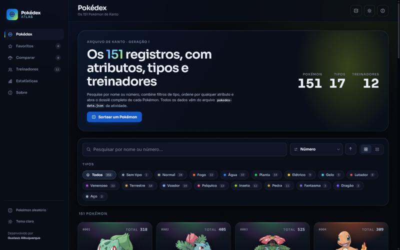
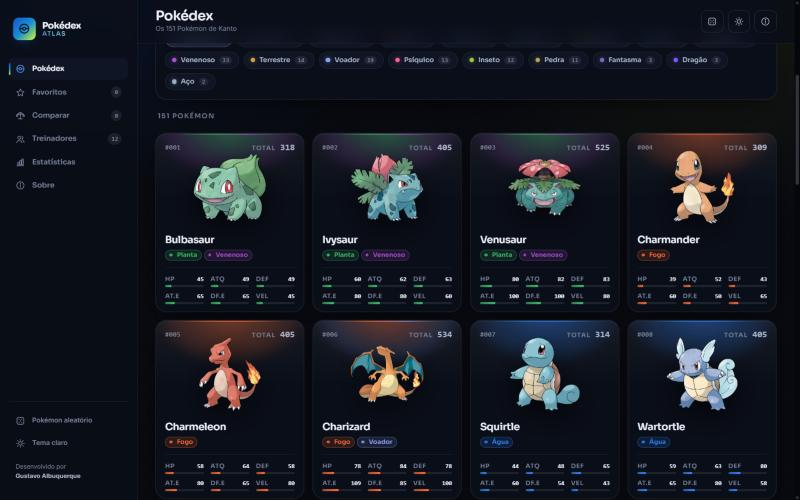
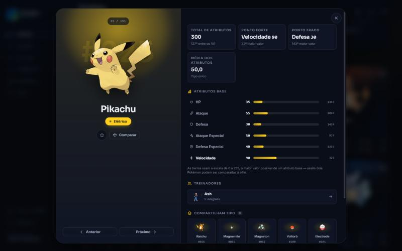
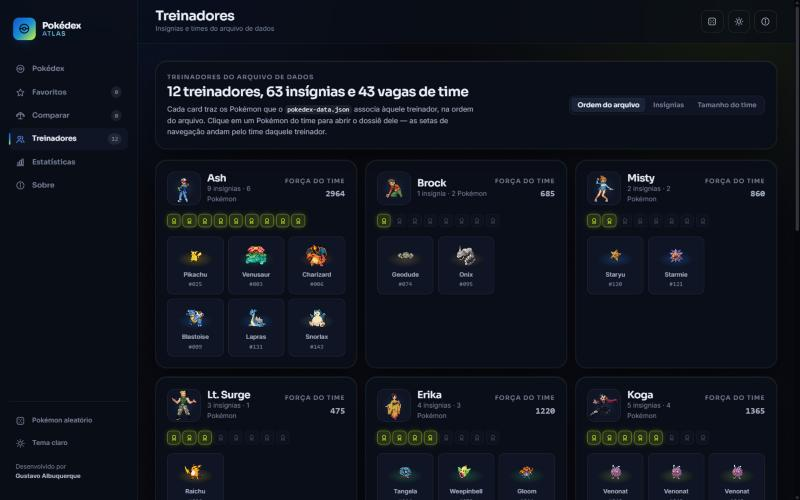
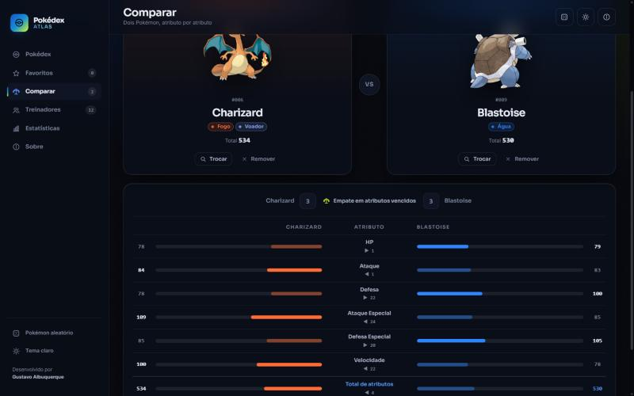
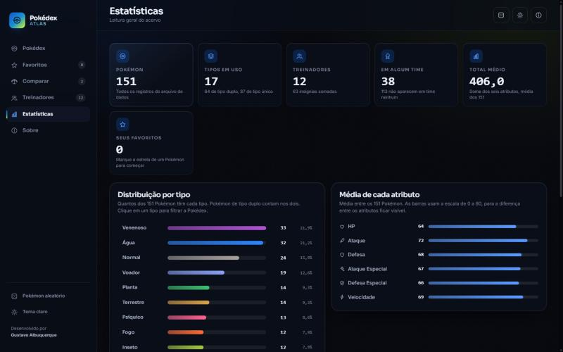
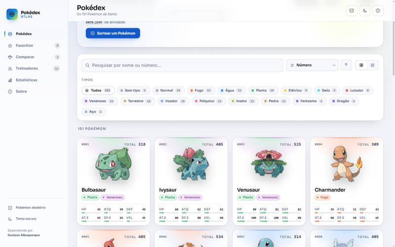
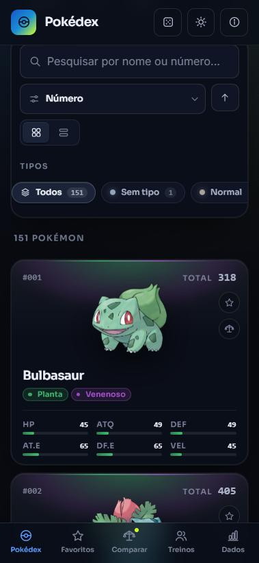
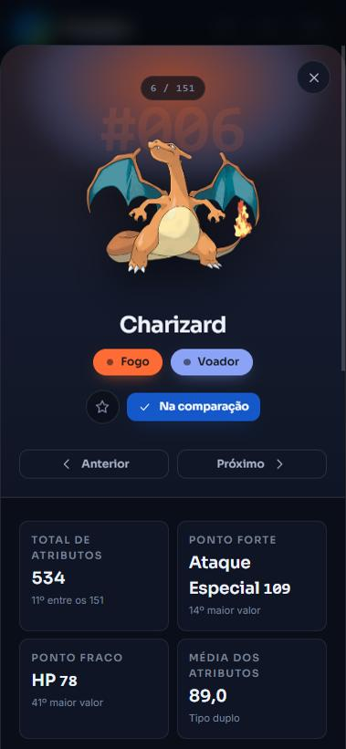

# 🔴 Pokédex Atlas

**Arquivo interativo dos 151 Pokémon de Kanto — React + Vite**

Desenvolvido por **Gustavo Albuquerque**  
Desenvolvimento e Integração de Aplicações Web — PUC Minas  
Atividade 03 — Pokédex com React + Vite (Prof. João Paulo Aramuni)



---

## 📖 Sobre o projeto

O **Pokédex Atlas** é uma aplicação web de página única que lê, organiza e apresenta
os dados do arquivo **`pokedex-data.json`** fornecido na atividade: 151 Pokémon com
os seis atributos base, 18 tipos e 12 treinadores com suas insígnias e times.

Não há back-end e não há banco de dados. O JSON é empacotado no build pelo Vite e todo
o resto — pesquisa, filtros, ordenação, comparação, estatísticas — é calculado no
navegador a partir dele. As imagens vêm de repositórios públicos e são apenas
complemento visual: **sem internet, a aplicação continua funcionando por inteiro**,
com um substituto desenhado em SVG no lugar das artes.

A identidade visual é própria e nasce de três cores — **Midnight Black `#030407`**,
**Electric Cobalt `#1558c9`** e **Acid Lime `#d4ff24`**: o preto é a base, o cobalto
marca o que é interativo e o lima marca o que merece destaque. Junto vêm a paleta de
tipos calibrada para os temas claro e escuro,
tipografia Sora + Inter, ícones SVG desenhados no projeto e um sistema de tokens de
design que governa cor, espaçamento, raio e movimento em toda a interface.

---

## ▶️ Como executar

Requisitos: **Node.js 20 ou superior** (testado na 24.22.1) e npm.

```bash
npm install
```

```bash
npm run dev
```

Depois de iniciar, abra no navegador:

```text
http://localhost:5173
```

> O Vite escolhe outra porta se a 5173 estiver ocupada — o endereço exato aparece no
> terminal.

### Outros comandos

```bash
npm run build
```

```bash
npm run preview
```

```bash
npm run lint
```

- `build` gera a versão de produção em `dist/`.
- `preview` serve o conteúdo de `dist/` para conferir o build.
- `lint` roda o **oxlint** sobre o código-fonte.

---

## 📂 Onde estão os dados

```text
src/data/pokedex-data.json
```

É o arquivo **original da atividade**, copiado sem nenhuma alteração
([fonte](https://github.com/joaopauloaramuni/desenvolvimento-e-integracao-de-aplicacoes-web/blob/main/ATIVIDADES/ATIVIDADE%2003%20-%20JSON/data/pokedex-data.json)).
Ele é a única fonte de verdade da aplicação:

| Chave      | Conteúdo                                                                 |
| ---------- | ------------------------------------------------------------------------ |
| `types`    | 18 tipos `{ id, name }` — inclui o tipo `Typeless` (id 0)                |
| `pokemon`  | 151 registros `{ id, name, stats { hp, attack, defense, specialAttack, specialDefense, speed }, types[] }` |
| `trainers` | 12 treinadores `{ id, name, badges, pokemonIds[] }`                      |

Dois detalhes do arquivo que a aplicação trata explicitamente:

- **Mew (#151) vem sem tipo** (`types: []`). Ele recebe o tipo `Typeless`, que existe
  na própria lista `types` do arquivo — nada é inventado.
- **`pokemonIds` pode repetir**: o Koga tem três Venonat. A ordem e as repetições são
  preservadas na exibição do time; a navegação entre Pokémon ignora as repetições.

---

## ✨ Funcionalidades

### Requisitos da atividade

- **Pokédex completa** — os 151 Pokémon, cada um com número, nome, tipos e os seis
  atributos (HP, Ataque, Defesa, Ataque Especial, Defesa Especial e Velocidade).
- **Pesquisa por nome ou número** — a lista responde a cada tecla. Aceita `bulba`,
  `BULBA`, `25`, `#25` e `025`; ignora acentos e pontuação, então `mr mime` encontra
  o *Mr. Mime* e `farfetchd` encontra o *Farfetch'd*. `Esc` limpa o campo.
- **Filtro por tipo** — uma chip por tipo presente no arquivo, com a cor do tipo e a
  quantidade. Vários tipos podem ser combinados, com modo **E** (tem todos) ou **OU**
  (tem algum).
- **Detalhes** — dossiê com arte grande, identificação, tipos, os seis atributos em
  barras animadas, a posição de cada atributo entre os 151, ponto forte, ponto fraco,
  treinadores que têm aquele Pokémon e outros Pokémon que compartilham tipo.
- **Treinadores** — os 12 do arquivo, com nome, insígnias, time completo e navegação
  entre os Pokémon de cada treinador.
- **Estados vazios tratados** — pesquisa sem resultado, filtro impossível e lista de
  favoritos vazia, sempre com a ação de saída.
- **Interface responsiva** — desktop, tablet e celular.

### Desafios opcionais

| Desafio                  | Como foi implementado                                                                 |
| ------------------------ | ------------------------------------------------------------------------------------- |
| ⭐ Favoritos             | Persistidos no `localStorage`, com tela própria, pesquisa, filtros e ordenação         |
| ⚔️ Comparação            | Dois Pokémon lado a lado, barras divergentes, placar e diferença por atributo          |
| 📊 Ordenação             | Número, nome, total e cada um dos seis atributos, crescente ou decrescente             |
| 🎲 Pokémon aleatório     | Botão no painel de abertura e na barra superior; abre o dossiê direto                  |
| 🌙 Dark Mode             | Tema claro e escuro, preferência guardada, aplicada antes do React para não piscar     |
| 📱 Responsividade        | Lateral completa, lateral só com ícones, e barra inferior no celular                   |

### Além do pedido

- **Visão em grade ou em lista** — a lista alinha os seis atributos em colunas, o que
  facilita comparar muitos Pokémon de uma vez. A escolha é guardada.
- **Painel de estatísticas** — distribuição por tipo, médias de cada atributo,
  recordistas e números gerais do acervo.
- **Histórico de pesquisas** — os últimos termos que *encontraram* algo.
- **Carregamento progressivo** — a grade cresce conforme a rolagem, em vez de montar
  os 151 cards de uma vez.
- **Rotas por hash** — cada tela e cada Pokémon têm endereço próprio
  (`#/treinadores/1`, `#/pokemon/25`): o estado sobrevive ao recarregar, o botão
  "voltar" do navegador funciona e o link pode ser compartilhado.
- **Acessibilidade** — navegação por teclado, foco visível, `aria-*` nos controles,
  foco preso e devolvido no modal, link de pulo para o conteúdo e respeito a
  `prefers-reduced-motion`.

---

## 🖼️ Capturas de tela

| Grade de Pokémon | Dossiê do Pokémon |
| :---: | :---: |
|  |  |

| Treinadores | Comparação |
| :---: | :---: |
|  |  |

| Estatísticas | Tema claro |
| :---: | :---: |
|  |  |

| Celular — Pokédex | Celular — dossiê |
| :---: | :---: |
|  |  |

---

## 🧩 Como o projeto está organizado

```text
pokedex-premium/
├── index.html                  Entrada, fontes e script que aplica o tema antes do React
├── vite.config.js              Configuração do Vite (base relativa, porta, build)
├── public/
│   └── favicon.svg             Ícone da marca
├── docs/                       Documentação técnica e acadêmica
└── src/
    ├── main.jsx                Monta a aplicação e define a ordem dos CSS globais
    ├── App.jsx                 Composição das telas, estado global e navegação
    │
    ├── config/
    │   └── appConfig.js        Identidade, chaves do localStorage, URLs de imagem, créditos
    │
    ├── data/
    │   └── pokedex-data.json   Fonte de dados da atividade (intacta)
    │
    ├── domain/                 Modelos: o dado cru vira objeto pronto para a tela
    │   ├── stats.js            Os seis atributos e seus rótulos
    │   ├── pokemonTypes.js     Paleta, tradução e cor de texto por contraste (WCAG)
    │   ├── pokemon.js          createPokemon
    │   └── trainer.js          createTrainer
    │
    ├── services/               Regras de negócio, sem React
    │   ├── pokedexRepository.js  Carga única do JSON e índices em memória
    │   ├── pokedexQuery.js       Pesquisa, filtro por tipo e ordenação
    │   └── pokedexInsights.js    Posições, médias, distribuição e comparação
    │
    ├── hooks/                  Estado reutilizável
    │   ├── useLocalStorage.js    Persistência à prova de armazenamento bloqueado
    │   ├── useTheme.js           Tema claro/escuro
    │   ├── useFavorites.js       Favoritos
    │   ├── useCompare.js         Os dois lados da comparação
    │   ├── useSearchHistory.js   Histórico de pesquisas
    │   ├── usePokedexQuery.js    Pesquisa + filtros + ordenação de uma lista
    │   ├── useProgressiveList.js Carregamento progressivo da grade
    │   ├── useHashRoute.js       Roteamento por hash
    │   └── useKeyboardShortcut.js Atalhos de teclado
    │
    ├── components/
    │   ├── ui/                 Peças genéricas: Icon, Modal, StatBar, TypeBadge...
    │   ├── layout/             AppShell e ErrorBoundary
    │   ├── pokemon/            Card, linha, grade, barra de ferramentas e dossiê
    │   ├── trainers/           Card de treinador
    │   ├── compare/            Lados, tabela e seletor da comparação
    │   └── insights/           Peças do painel de estatísticas
    │
    ├── views/                  Uma tela por arquivo
    │   ├── PokedexView.jsx
    │   ├── FavoritesView.jsx
    │   ├── CompareView.jsx
    │   ├── TrainersView.jsx
    │   ├── StatsView.jsx
    │   └── AboutView.jsx
    │
    ├── styles/
    │   ├── tokens.css          Cor, tipografia, espaçamento, raio e tempos
    │   └── base.css            Reset, base do documento, utilitários e animações
    │
    └── utils/
        └── text.js             Normalização de texto, número, plural e ordinal
```

Cada componente tem o CSS colocalizado (`PokemonCard.jsx` + `PokemonCard.css`), e
nenhum arquivo de estilo define cor ou medida "solta": todos consomem os tokens.

**51 arquivos JavaScript/JSX e 32 folhas de estilo, cerca de 8,6 mil linhas.**

---

## ⚛️ Conceitos de React aplicados

| Conceito                     | Onde ver                                                                 |
| ---------------------------- | ------------------------------------------------------------------------ |
| Componentes funcionais       | Todos os componentes, exceto `ErrorBoundary` (precisa de `componentDidCatch`) |
| Props                        | `PokemonCard`, `StatBar`, `TrainerCard`, `AppShell`...                   |
| `useState`                   | `usePokedexQuery`, `App`, `SearchField`, `TrainersView`                  |
| `useEffect`                  | `useLocalStorage`, `useTheme`, `useProgressiveList`, `Modal`             |
| `useMemo` (estado derivado)  | `usePokedexQuery`, `FavoritesView`, `StatsView`, `PokemonDetails`        |
| `useCallback`                | `App`, `usePokedexQuery`, `useFavorites`                                 |
| `useRef`                     | `Modal` (foco), `useProgressiveList` (sentinela), `SearchField`          |
| `memo`                       | `PokemonCard` e `PokemonRow` — favoritar redesenha só o card alterado    |
| Renderização com `map()`     | `PokemonCollection`, `TypeFilterBar`, `TrainerCard`, `CompareTable`      |
| Eventos                      | Cliques, teclado (`Esc`, setas), `change`, `focus`/`blur`                |
| Hooks próprios               | Nove, em `src/hooks/`                                                    |
| Portais                      | `Modal`, montado em `document.body`                                      |

---

## 🌐 Fontes externas e créditos

| Fonte | Uso | Observação |
| ----- | --- | ---------- |
| [`pokedex-data.json`](https://github.com/joaopauloaramuni/desenvolvimento-e-integracao-de-aplicacoes-web/blob/main/ATIVIDADES/ATIVIDADE%2003%20-%20JSON/data/pokedex-data.json) | **Todos os dados** da aplicação | Fornecido na atividade, mantido intacto |
| [PokéAPI — repositório de sprites](https://github.com/PokeAPI/sprites) | Artes oficiais e sprites dos Pokémon | URLs montadas a partir do ID, sem chamada de API |
| [Pokémon Showdown](https://play.pokemonshowdown.com/sprites/trainers/) | Sprites dos treinadores | Apenas imagem; nenhum dado vem daqui |
| [Google Fonts](https://fonts.google.com/) | Tipografia **Sora** e **Inter** | Carregadas no `index.html` |

As imagens são **complemento visual e opcional**. Se a PokéAPI ou o Showdown estiverem
fora do ar, cada imagem cai para o próximo endereço candidato e, no fim, para o SVG
local `src/assets/sem-imagem.svg` (ou para as iniciais, no caso dos treinadores).

Pokémon e seus nomes são marcas registradas da Nintendo / Creatures Inc. / GAME FREAK.
Este é um trabalho acadêmico sem fins comerciais.

---

## 📚 Documentação técnica

| Documento | O que contém |
| --------- | ------------ |
| [`docs/ANALISE-PROJETO-ORIGINAL.md`](docs/ANALISE-PROJETO-ORIGINAL.md) | Engenharia reversa do projeto de referência, diagnóstico e plano de evolução |
| [`docs/ARQUITETURA.md`](docs/ARQUITETURA.md) | Camadas, fluxo de dados, decisões técnicas e sistema de design |
| [`docs/MATRIZ-CONFORMIDADE.md`](docs/MATRIZ-CONFORMIDADE.md) | Requisito por requisito do enunciado, com onde está implementado |
| [`docs/RELATORIO-TESTES.md`](docs/RELATORIO-TESTES.md) | Testes executados, resultados e defeitos corrigidos |
| [`docs/MELHORIAS.md`](docs/MELHORIAS.md) | Lista das melhorias em relação ao projeto de referência |

---

## 👤 Autoria

**Desenvolvido por Gustavo Albuquerque.**

O enunciado da atividade, o arquivo `pokedex-data.json` e o projeto de referência da
disciplina são de autoria do **Prof. João Paulo Aramuni** e estão publicados sob
licença MIT (cópia preservada em [`docs/LICENSE-ORIGINAL-ARAMUNI.txt`](docs/LICENSE-ORIGINAL-ARAMUNI.txt)).
O código desta aplicação foi escrito do zero por Gustavo Albuquerque e está sob a
licença MIT em [`LICENSE`](LICENSE).

---

## 📄 Licença

MIT — veja [`LICENSE`](LICENSE).
