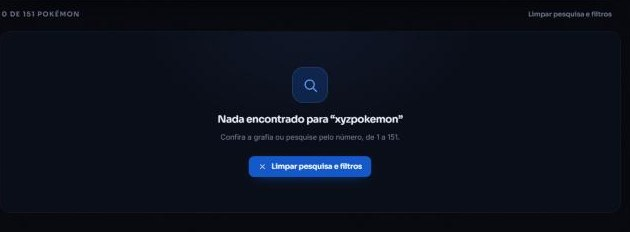

# Relatório de testes

Pokédex Atlas — React + Vite  
Testes executados no navegador, com a aplicação rodando em `npm run dev`.

**Ambiente:** Windows 11 · Node 24.22.1 · npm 11.19.1 · Vite 8.3.7 · React 19.3
**Navegador:** Chromium, com emulação de viewport para 1440×900, 1366×860 e 375×812

Cada resultado abaixo foi obtido **interagindo com a aplicação** — clique, digitação,
teclado — e lendo o estado real do DOM e do `localStorage` depois da interação. Nenhum
item foi marcado como aprovado por inspeção de código.

---

## 1. Instalação, build e análise estática

| # | Verificação | Comando | Resultado |
| - | ----------- | ------- | --------- |
| 1.1 | Instalação das dependências | `npm install` | ✅ 0 vulnerabilidades |
| 1.2 | Servidor de desenvolvimento | `npm run dev` | ✅ Pronto em 1,9 s |
| 1.3 | Build de produção | `npm run build` | ✅ 98 módulos, 652 ms — JS 318,85 kB (gzip 94,10 kB), CSS 71,14 kB (gzip 11,76 kB) |
| 1.4 | Análise estática | `npx oxlint --deny-warnings src` | ✅ Sem erros e sem avisos |
| 1.5 | Console do navegador | Recarga limpa da página | ✅ Sem erros e sem avisos (só as mensagens normais do Vite e do React DevTools) |
| 1.6 | **Versão de produção** | `npx vite preview` + endereço direto `#/treinadores/6` | ✅ 12 treinadores, card do Koga destacado, console sem nenhuma mensagem |

---

## 2. Pokédex e exibição

| # | Caso de teste | Esperado | Obtido | |
| - | ------------- | -------- | ------ | - |
| 2.1 | Carregar a aplicação | 151 Pokémon no acervo | Contagem exibe `151 Pokémon` | ✅ |
| 2.2 | Grade inicial | Primeira fatia renderizada | 36 cards no DOM | ✅ |
| 2.3 | Conteúdo do card | Número, nome, tipos e os 6 atributos | Bulbasaur `#001`, Planta + Venenoso, HP 45 / ATQ 49 / DEF 49 / AT.E 65 / DF.E 65 / VEL 45, total 318 | ✅ |
| 2.4 | Tipos do arquivo | Só os tipos em uso | 17 chips (o tipo `Dark` existe no JSON, mas nenhum Pokémon o usa) | ✅ |
| 2.5 | Mew sem tipo no arquivo | Recebe `Typeless` sem quebrar | Chip "Sem tipo 1"; Mew renderiza normalmente | ✅ |
| 2.6 | Visão em lista | Linhas com os 6 atributos em colunas | 36 linhas, colunas alinhadas | ✅ |
| 2.7 | Preferência de visão | Guardada entre sessões | `atlas:density = "list"` no `localStorage` | ✅ |

---

## 3. Pesquisa

| # | Termo digitado | Esperado | Obtido | |
| - | -------------- | -------- | ------ | - |
| 3.1 | `char` | Os três da linha do Charmander | Charmander, Charmeleon, Charizard — `3 de 151 Pokémon` | ✅ |
| 3.2 | `025` | Pikachu | Pikachu — `1 de 151 Pokémon` | ✅ |
| 3.3 | `#25` | Pikachu | Pikachu | ✅ |
| 3.4 | `mr mime` | Mr. Mime (pontuação ignorada) | Mr. Mime | ✅ |
| 3.5 | `farfetchd` | Farfetch'd (apóstrofo ignorado) | Farfetch'd | ✅ |
| 3.6 | `zzzz` | Estado vazio com ação | "Nada encontrado para “zzzz”" + "Confira a grafia ou pesquise pelo número, de 1 a 151." + botão limpar | ✅ |

| 3.7 | Digitação contínua | Lista atualiza a cada tecla, sem botão | Resultado muda a cada caractere | ✅ |
| 3.8 | `Esc` no campo | Limpa a pesquisa | Campo esvaziado, lista restaurada | ✅ |

---

## 4. Filtros e combinação com a pesquisa

| # | Caso de teste | Esperado | Obtido | |
| - | ------------- | -------- | ------ | - |
| 4.1 | Clicar na chip "Planta" | Só os de tipo Planta | `14 de 151 Pokémon` (bate com o contador da chip) | ✅ |
| 4.2 | Acrescentar "Venenoso" (modo **E**) | Só quem tem os dois tipos | `9 de 151` — as linhas do Bulbasaur, Oddish e Bellsprout | ✅ |
| 4.3 | Controle **E/OU** | Aparece só com 2+ tipos | Surge ao marcar o segundo tipo | ✅ |
| 4.4 | Trocar para **OU** | União dos dois tipos | `38 de 151` (14 + 33 − 9 de interseção) | ✅ |
| 4.5 | **Pesquisa + filtro juntos** | Ambas as condições aplicadas | `bulba` + (Planta OU Venenoso) → apenas Bulbasaur | ✅ |
| 4.6 | Filtro impossível | Estado vazio específico | Mensagem explica a combinação E e sugere trocar para OU | ✅ |
| 4.7 | "Limpar pesquisa e filtros" | Volta aos 151 | `151 Pokémon` | ✅ |
| 4.8 | Chips com contagem zero | Desativadas, não escondidas | Ficam visíveis e `disabled` (a barra não "pula" a cada letra digitada) | ✅ |

---

## 5. Ordenação

| # | Campo e direção | Esperado | Obtido (3 primeiros) | |
| - | --------------- | -------- | -------------------- | - |
| 5.1 | Número ↑ | Ordem da Pokédex | Bulbasaur, Ivysaur, Venusaur | ✅ |
| 5.2 | Nome ↑ | Alfabética pt-BR | Abra, Aerodactyl, Alakazam | ✅ |
| 5.3 | Total ↓ | Maiores somas | Mewtwo (680), Dragonite (600), Mew (600) | ✅ |
| 5.4 | HP ↓ | Maiores HP | Chansey (250), Snorlax (160), Wigglytuff (140) | ✅ |
| 5.5 | HP ↑ (inverter) | Menores HP | Diglett (10), Magikarp (20), Abra (25) | ✅ |
| 5.6 | Ataque ↓ | Maiores ataques | Dragonite (134), Machamp (130), Kingler (130) | ✅ |
| 5.7 | Opções disponíveis | 9 campos | Número, Nome, Total, HP, Ataque, Defesa, At. Especial, Def. Especial, Velocidade | ✅ |

---

## 6. Detalhes do Pokémon

| # | Caso de teste | Esperado | Obtido | |
| - | ------------- | -------- | ------ | - |
| 6.1 | Clicar num card | Abre o dossiê e a URL muda | `#/pokemon/6`, painel do Charizard | ✅ |
| 6.2 | Conteúdo | ID, nome, tipos, arte, 6 atributos em barras | Todos presentes; barras na escala 0–255 | ✅ |
| 6.3 | Informações derivadas | Total, posição, ponto forte e fraco | Total 534 (11º entre os 151); forte: At. Especial 109 (14º); fraco: HP 78 (41º) | ✅ |
| 6.4 | Treinadores do Pokémon | Quem tem Charizard no time | Ash (9 insígnias) | ✅ |
| 6.5 | Compartilham tipo | Fogo ∪ Voador, menos ele | 28 — confere com 12 Fogo + 19 Voador − 1 (ele) − 2 (duplos) | ✅ |
| 6.6 | `→` no teclado | Vai para o próximo | `#/pokemon/7`, Squirtle, "7 / 151" | ✅ |
| 6.7 | `←` no teclado | Volta para o anterior | `#/pokemon/6`, Charizard | ✅ |
| 6.8 | `Esc` | Fecha e volta para a lista | URL volta a `#/pokedex` | ✅ |
| 6.9 | **Devolução do foco** | Foco volta ao card que abriu | `document.activeElement` = `.pokemon-card__surface` | ✅ |
| 6.10 | **Endereço direto** | Abrir `#/pokemon/150` do zero | Mewtwo aberto, "150 / 151", navegação ativa | ✅ |

---

## 7. Treinadores e relacionamentos

| # | Caso de teste | Esperado | Obtido | |
| - | ------------- | -------- | ------ | - |
| 7.1 | Abrir a área de treinadores | Os 12 do arquivo | 12 cards; cabeçalho "12 treinadores, 63 insígnias e 43 vagas de time" | ✅ |
| 7.2 | Insígnias | Número e medidor | Ash 9 (medidor com 9 marcas acesas), Brock 1, Giovanni 8 | ✅ |
| 7.3 | Time do Ash | `[25, 3, 6, 9, 131, 143]` do JSON | Pikachu, Venusaur, Charizard, Blastoise, Lapras, Snorlax — nessa ordem | ✅ |
| 7.4 | **Repetições preservadas** | Koga com três Venonat | Time exibe Venonat, Venonat, Venonat, Venomoth | ✅ |
| 7.5 | Abrir Pokémon do time | Navegação **dentro do time** | Venusaur do time do Ash abre como "2 / 6" | ✅ |
| 7.6 | Navegação com repetição | Sem botão morto | No time do Koga, Venonat é "1 / 2" e "próximo" leva ao Venomoth (IDs desduplicados) | ✅ |
| 7.7 | Dossiê → treinador | Vai ao card certo, destacado | Pikachu → clicar em Ash → `#/treinadores/1`, card do Ash destacado e focado | ✅ |
| 7.8 | Fechar e voltar | Retorna à tela de origem | Fechar o dossiê aberto pelo time volta para `#/treinadores/1` | ✅ |
| 7.9 | Ordenação dos treinadores | Arquivo / insígnias / tamanho do time | As três ordens funcionam | ✅ |

---

## 8. Favoritos (localStorage)

| # | Caso de teste | Esperado | Obtido | |
| - | ------------- | -------- | ------ | - |
| 8.1 | Marcar três estrelas | IDs gravados | `atlas:favorites = [1,4,7]` | ✅ |
| 8.2 | Contador da navegação | Atualiza na hora | "Favoritos 3" | ✅ |
| 8.3 | **Persistência** | Sobrevive ao recarregar | Depois de `F5`: `[1,4,7]`, aba mostra Bulbasaur, Charmander, Squirtle | ✅ |
| 8.4 | Aba de favoritos | Mesma pesquisa, filtro e ordenação | Barra de ferramentas completa, contagem "3 favoritos" | ✅ |
| 8.5 | Desmarcar | Sai da lista e do armazenamento | Removido dos dois | ✅ |
| 8.6 | Limpar tudo | Esvazia e mostra o estado vazio | `atlas:favorites = []` + "Você ainda não tem favoritos" com botão para a Pokédex | ✅ |

---

## 9. Comparação

| # | Caso de teste | Esperado | Obtido | |
| - | ------------- | -------- | ------ | - |
| 9.1 | Abrir com os lados vazios | Dois alvos e um estado vazio | "Escolha dois Pokémon para comparar" | ✅ |
| 9.2 | Escolher o primeiro | Seletor com pesquisa | Charizard → `atlas:compare = [6,null]` | ✅ |
| 9.3 | Escolher o segundo | Tabela aparece | Blastoise → `[6,9]`, tabela montada | ✅ |
| 9.4 | Tabela | Barras divergentes e diferenças | 6 atributos + total, colunas alinhadas, vencedor destacado | ✅ |
| 9.5 | Placar | Quem vence mais atributos | "Charizard 3 — Empate em atributos vencidos — 3 Blastoise" (HP 78×79, ATQ 84×83, DEF 78×100, AT.E 109×85, DF.E 85×105, VEL 100×78) | ✅ |
| 9.6 | Persistência | Escolha sobrevive ao recarregar | `atlas:compare` mantém `[6,9]` | ✅ |
| 9.7 | Marcar pela grade | Balança do card entra na comparação | Card marcado aparece no comparador | ✅ |
| 9.8 | Evitar duplicata | Mesmo Pokémon dos dois lados | O seletor esconde quem já está do outro lado | ✅ |

---

## 10. Estatísticas

| # | Verificação | Conferência independente | Obtido | |
| - | ----------- | ------------------------ | ------ | - |
| 10.1 | Total de Pokémon | 151 no arquivo | 151 | ✅ |
| 10.2 | Tipos em uso | 18 no arquivo, 1 sem uso | 17 | ✅ |
| 10.3 | Treinadores e insígnias | 12 treinadores | 12, 63 insígnias | ✅ |
| 10.4 | Em algum time | IDs distintos em `pokemonIds` | 38 (113 sem treinador) | ✅ |
| 10.5 | Distribuição por tipo | Igual aos contadores das chips | Venenoso 33, Água 32, Normal 24, Voador 19, Planta 14, Terrestre 14… | ✅ |
| 10.6 | Recordista de HP | Chansey, 250 | Chansey 250 | ✅ |
| 10.7 | Recordista de Ataque | Dragonite, 134 | Dragonite 134 | ✅ |
| 10.8 | Recordista de Defesa | Cloyster, 180 | Cloyster 180 | ✅ |
| 10.9 | Recordista de At. Especial | Mewtwo, 154 | Mewtwo 154 | ✅ |
| 10.10 | Recordista de Def. Especial | Articuno, 125 | Articuno 125 | ✅ |
| 10.11 | Recordista de Velocidade | Electrode, 140 | Electrode 140 | ✅ |
| 10.12 | Recordista de Total | Mewtwo, 680 | Mewtwo 680 | ✅ |
| 10.13 | Clicar num tipo | Leva à Pokédex filtrada | Filtro aplicado na tela da Pokédex | ✅ |

---

## 11. Tema, rotas e extras

| # | Caso de teste | Esperado | Obtido | |
| - | ------------- | -------- | ------ | - |
| 11.1 | Alternar o tema | Tema troca e é guardado | `data-theme="light"`, `atlas:theme = "light"`, `theme-color` passa a `#f4f5f8` | ✅ |
| 11.2 | Recarregar no tema claro | Abre claro, sem piscar | Script do `index.html` aplica antes do React | ✅ |
| 11.3 | Pokémon aleatório | Abre um dossiê ao acaso | `#/pokemon/39` (Jigglypuff) | ✅ |
| 11.4 | Carregamento progressivo | Grade cresce | 36 → 72, indicador "72 / 151" | ✅ |
| 11.5 | Rotas | Cada tela tem endereço | `#/pokedex`, `#/favoritos`, `#/comparar`, `#/treinadores`, `#/treinadores/1`, `#/estatisticas`, `#/sobre` | ✅ |
| 11.6 | Rolagem ao trocar de tela | Volta ao topo | Sair da Pokédex rolada e entrar em "Sobre" abre no topo | ✅ |
| 11.7 | Histórico de pesquisas | Guarda termos com resultado | Aparece ao focar o campo vazio | ✅ |

---

## 12. Responsividade

| # | Largura | Esperado | Obtido | |
| - | ------- | -------- | ------ | - |
| 12.1 | 1440 px | Lateral completa, grade em 3–4 colunas | Confirmado | ✅ |
| 12.2 | 1366 px | Idem | Confirmado | ✅ |
| 12.3 | ~1100 px | Lateral só com ícones; linhas da lista empilham os atributos | Confirmado | ✅ |
| 12.4 | 375 px (celular) | Barra inferior, cards em 1 coluna, chips com rolagem lateral | Confirmado | ✅ |
| 12.5 | 375 px — dossiê | Folha que sobe de baixo | Confirmado; destaques em 2 colunas | ✅ |
| 12.6 | Toque | Ações do card sempre visíveis | `@media (hover: none)` mantém estrela e balança visíveis | ✅ |

---

## 13. Defeitos encontrados durante os testes e corrigidos

Todos encontrados testando no navegador e corrigidos neste mesmo ciclo.

| # | Defeito | Causa | Correção |
| - | ------- | ----- | -------- |
| 13.1 | **"Anterior/Próximo" mortos ao abrir um Pokémon por endereço direto** | A ordem de navegação guardada era a da última lista visitada; um Pokémon fora dela retornava `indexOf === -1` | `App.jsx` passou a validar a ordem: se o Pokémon aberto não pertence a ela, usa a Pokédex inteira |
| 13.2 | **Colunas desalinhadas na tabela de comparação** | `display: flex` aplicado na própria `<td>` tira a célula do contexto de tabela | O `flex` foi para um `` interno; as células voltaram a ser células |
| 13.3 | **Vão vazio de ~290 px no seletor da comparação** | `.search-field` tem `flex: 1 1 18rem` para crescer na barra horizontal; dentro de uma coluna, cresceu na vertical | `flex: 0 0 auto` no campo quando está dentro do seletor |
| 13.4 | **Dossiê sem rolagem independente no desktop** | `max-height` num grid não limita a linha automática, então as colunas cresciam além do painel | Altura resolvida (`height: min(...)`) + `grid-template-rows: minmax(0, 1fr)` |
| 13.5 | **Número gigante do dossiê sobre o nome e os botões** | Posicionado em 38% da altura | Movido para o topo, atrás da arte |
| 13.6 | **Botão de fechar sobre o primeiro destaque** | Modal e conteúdo disputavam o canto superior direito | Recuo de topo na coluna de dados |
| 13.7 | **"3 favorito" no singular** | A forma plural recebida era igual à singular | Prop `totalLabelPlural` separada |
| 13.8 | **Rótulos vazando na lateral estreita** | Só os rótulos da navegação eram escondidos no modo compacto | Os rótulos das ações também passaram a ser escondidos |
| 13.9 | **Marca da seção ativa invisível** | Posicionada fora do botão, era recortada pela rolagem da lista | Movida para dentro do botão |
| 13.10 | **Gráfico de médias ilegível** | Escala igual à maior média deixava todas as barras quase cheias | Escala arredondada para a dezena seguinte (0–80) |
| 13.11 | **Texto auxiliar com contraste baixo** | `--text-faint` perto de 2,5:1 nos dois temas | Tons ajustados para ~4,5:1 |
| 13.12 | **Rolagem herdada ao trocar de tela** | Nada repunha a posição na mudança de rota | Efeito que volta ao topo quando a tela muda (e só quando ela muda) |
| 13.13 | **Avisos do oxlint** | Refs lidas durante a renderização, `setState` dentro de efeito, hook sem uso, imports mortos | `useLocalStorage` reescrito com conversores constantes; `useProgressiveList` passou a ajustar o estado durante a renderização; arquivos e imports removidos |

| 13.14 | **Ponto de “novidade” permanente na barra inferior** | O ponto aparecia sempre que o item tinha contagem, e Treinadores tem 12 fixos | O ponto passou a valer só para o que é do usuário: favoritos e comparação |
| 13.15 | **Texto do botão primário ilegível sobre o degradê** | Encontrado ao trocar a paleta: o botão usava `color: #fff` sobre `--brand-gradient`, que agora termina em lima. Branco sobre `#d4ff24` dá 1,1:1 | O botão primário passou a ser cobalto sólido (`--accent-strong`) com tinta branca: 6,4:1 |
| 13.16 | **Texto recortado em degradê abaixo do mínimo** | A palavra "Atlas" da marca e os números do painel usam `background-clip: text`. Com o cobalto cheio na rampa, a primeira parada ficava em 3,2:1 | Rampa separada `--brand-gradient-text`, redefinida por tema, com todas as paradas acima de 4,5:1 |
---

## 14. Limitações conhecidas

| Item | Observação |
| ---- | ---------- |
| Testes automatizados | O projeto não tem suíte automatizada. A atividade não pede, e o esforço foi para a verificação manual registrada aqui. As camadas `services/` são funções puras, prontas para receber testes de unidade. |
| Imagens | Dependem da PokéAPI e do Pokémon Showdown. Sem internet, a aplicação funciona por inteiro, mas com o substituto em SVG no lugar das artes. |
| Navegadores | Verificado em Chromium. O CSS usa `color-mix()`, `@media (width <= …)` e `:has`-free seletores — todos suportados por Chrome, Edge, Firefox e Safari recentes; navegadores antigos não são alvo. |
| Repetição no time | Quando um treinador tem o mesmo Pokémon mais de uma vez, o dossiê abre uma vez só para aquele ID (a URL identifica o Pokémon, não a vaga no time). O time continua exibindo todas as repetições. |

---

## 15. Verificação da paleta

A identidade passou a ser construída sobre três cores: **Midnight Black `#030407`**
(principal), **Electric Cobalt `#1558c9`** (secundária) e **Acid Lime `#d4ff24`**
(terciária). A paleta dos 18 tipos de Pokémon **não** foi alterada — ela é semântica
e exigida pela atividade.

Os contrastes abaixo foram **medidos na aplicação rodando**, lendo as variáveis CSS
resolvidas e aplicando a fórmula de luminância relativa da WCAG, não estimados.

### Tema escuro (sobre `--bg-base` `#05070d`)

| Token | Cor | Contraste | Mínimo exigido |
| ----- | --- | --------- | -------------- |
| `--text-primary` | `#eef2fa` | 17,95:1 | 4,5:1 ✅ |
| `--text-secondary` | `#abb5ca` | 9,78:1 | 4,5:1 ✅ |
| `--text-muted` | `#7a849d` | 5,39:1 | 4,5:1 ✅ |
| `--text-faint` | `#7b8398` | 5,32:1 | 4,5:1 ✅ |
| `--accent` | `#5c9bff` | 7,28:1 | 4,5:1 ✅ |
| `--highlight` | `#d4ff24` | 17,39:1 | 4,5:1 ✅ |
| `--focus-ring` | `#d4ff24` | 17,39:1 | 3:1 ✅ |
| Botão primário | branco sobre `#1558c9` | 6,42:1 | 4,5:1 ✅ |

### Tema claro (sobre `--surface-1` `#ffffff`)

| Token | Cor | Contraste | Mínimo exigido |
| ----- | --- | --------- | -------------- |
| `--text-primary` | `#030407` | 20,50:1 | 4,5:1 ✅ |
| `--text-secondary` | `#434c61` | 8,59:1 | 4,5:1 ✅ |
| `--text-muted` | `#646d85` | 5,16:1 | 4,5:1 ✅ |
| `--text-faint` | `#6a7284` | 4,82:1 | 4,5:1 ✅ |
| `--accent` | `#1558c9` | 6,42:1 | 4,5:1 ✅ |
| `--highlight` | `#52700a` | 5,71:1 | 4,5:1 ✅ |
| Lima de preenchimento | `#030407` sobre `#d4ff24` | 17,70:1 | 4,5:1 ✅ |

### Por que o lima muda de tom no tema claro

`#d4ff24` lido como texto sobre branco dá **1,08:1** — invisível. Por isso o token
`--highlight` escurece para `#52700a` no tema claro, enquanto `--highlight-fill`
continua sendo o lima puro para preenchimentos, sempre com tinta preta por cima.
No tema escuro os dois são a mesma cor.

### O que foi verificado além do contraste

| # | Verificação | Resultado |
| - | ----------- | --------- |
| 15.1 | Nenhum literal da paleta antiga restou no código | `grep` por `e8384f`, `ff7a3d`, `ffc53d`, `232 56 79`, `d9452b`, `07080c` e `--brand-crimson`/`--brand-amber`: zero ocorrências |
| 15.2 | `oxlint --deny-warnings src` | Sem erros e sem avisos |
| 15.3 | `npm run build` | Sem avisos — 318,95 kB JS (94,13 kB gzip), 71,57 kB CSS (11,82 kB gzip) |
| 15.4 | Console do navegador | Zero erros nas seis telas |
| 15.5 | Cores de tipo preservadas | Bulbasaur segue verde, Charmander laranja, Pikachu amarelo; o filtro segue com 17 chips |
| 15.6 | `meta[name=theme-color]` acompanha o tema | `#030407` no escuro, `#f3f5fa` no claro, trocando junto com o botão |
| 15.7 | Favicon | Redesenhado com o degradê cobalto → lima sobre o preto da marca |
| 15.8 | As 10 capturas da documentação | Refeitas com a nova paleta, nos dois temas e nos dois tamanhos de tela |
